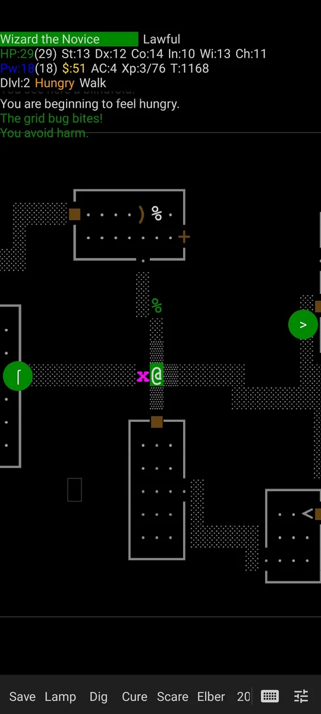
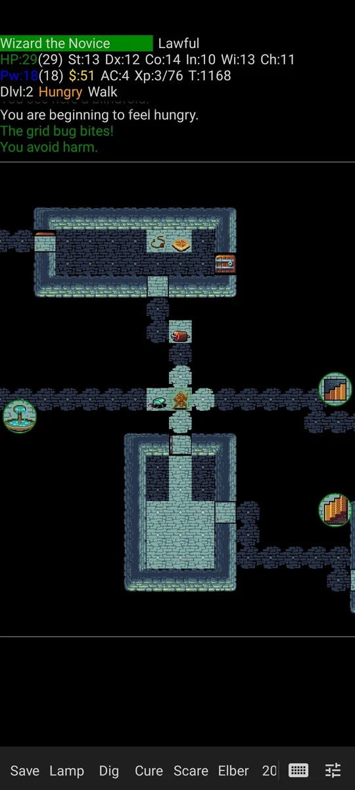
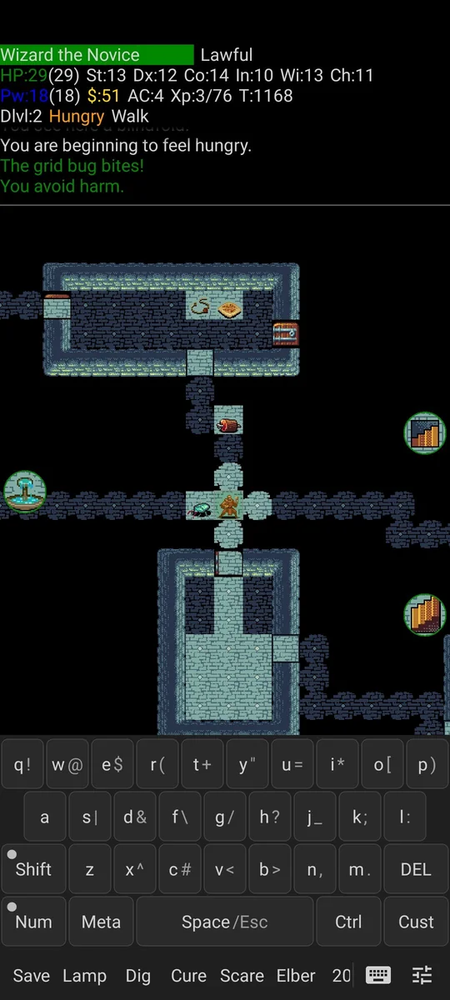
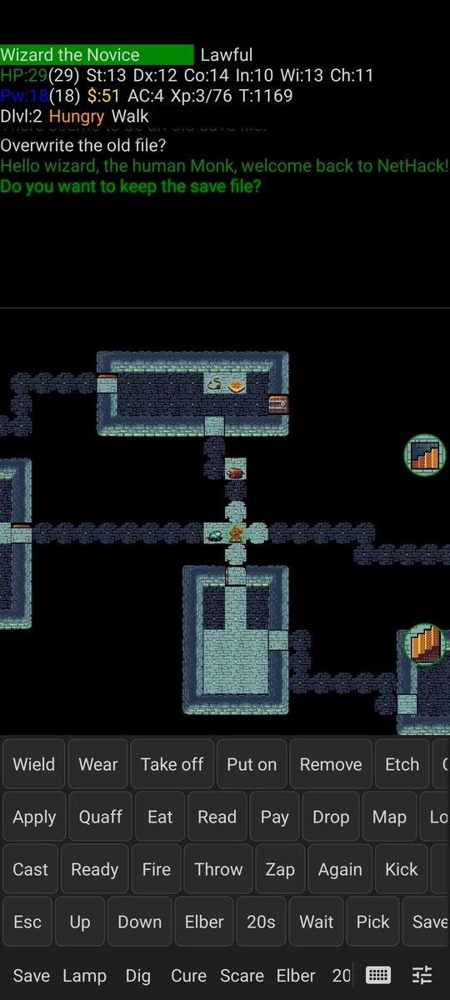
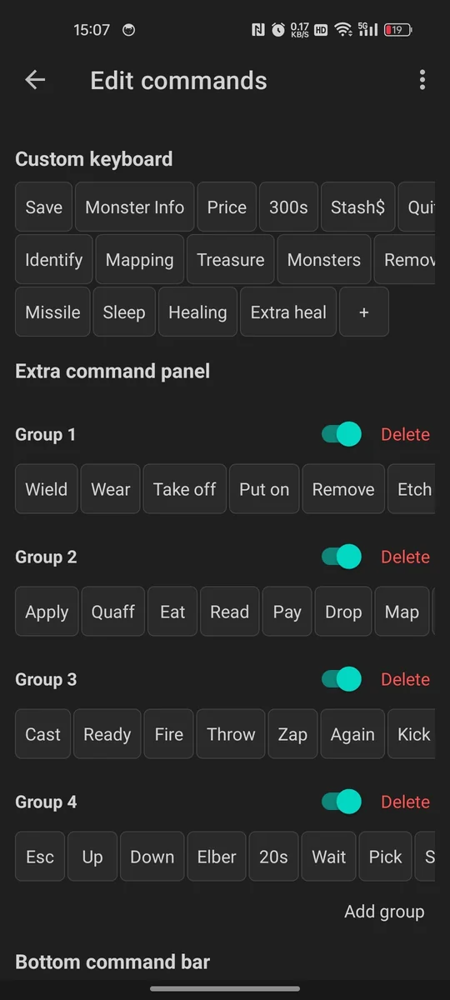

# ANetHack

ANetHack is a NetHack client for Android. The Android UI is written in Kotlin and
connects to the NetHack C core through JNI.

## Related projects

- https://github.com/gurrhack/NetHack-Android
- https://github.com/NetHack/NetHack

## Features

- NetHack game core with a native Android UI
- Status and message bars with a customizable bottom command bar
- ASCII and tile-based map rendering
- Map dragging, pinch zoom, tap to move and long-press to inspect
- Cursor/player following, dead-zone following and optional smooth camera
- Position indicators for stairs, items and the last travel target
- Travel, Run and Look map actions
- In-game message history with item and monster information
- Soft keyboard, command editing and shortcuts
- Sound effects, themes, map and UI preferences

## Screenshots

| ASCII map | Tile map |
| --- | --- |
|  |  |

| Keyboard | Extra command panel | Edit commands |
| --- | --- | --- |
|  |  |  |

## Runtime

- Minimum supported version: Android 10 (API 29)
- Target SDK: 34

## Bundled NetHack data

Some files come from an upstream NetHack build and cannot be generated by this
Android project alone. They are checked in so the project can be built directly:

- `app/src/main/cpp/generated/tile.c` — generated tile data.
- `app/src/main/assets/nethackdir/nhdat` — compiled NetHack game data archive.
- `app/src/main/assets/nethackdir/` — supporting data such as `symbols`,
  `sysconf`, `license` and default configuration files.
- `app/src/main/assets/tiles/*.png` — tile sheets produced from NetHack tiles.

When updating the NetHack submodule, these generated files may also need to be
regenerated from the corresponding upstream tools.

## Build requirements

- Android Studio 2026.2.2
- JDK 17
- Android SDK 34
- Android NDK 28.2.13676358
- CMake 3.22.1
